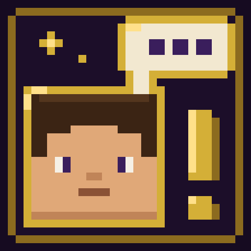

<p align="center"></p>

# NPC Maker

**Build your own NPCs in game.** Give them a look, stats and gear, teach them how to behave with simple
"when → then" rules, put them in factions, write branching conversations, hand out quests, and bring them to life
with animations, particles and sounds. Everything is edited in friendly in-game screens, with help on every field.

For Minecraft **26.3**, on **Fabric** and **NeoForge**. Made by EarlGreyFae, free for everyone (MIT licence).

> **Beta:** NPC Maker is new. Back up your world before trying it, and please report anything odd on the
> [issue tracker](https://github.com/EarlGreyFae/npc-maker/issues).

## Features

- **Looks:** player skins (by name or uploaded PNG), slim or wide arms, size, name and name colour, or turn an NPC
  into **any mob from the game or your mods**, or into **your own Blockbench model**.
- **Stats and gear:** health, strength, armour, speed, knockback resistance, worn and held items, and an
  inventory the NPC really uses (healing potions, milk, food, a bow and arrows, torches for dark spots).
- **Behaviour:** ready-made AI templates (guard, townsfolk, bandit, companion), wandering, patrol routes set with
  the NPC Wand, fleeing and hiding, respawning, and **AI rules**: *when* a player comes near / it's attacked / it's
  night…, *if* a condition holds, *then* attack, flee, go home, say a line, play a sound or animation, emit
  particles, use or place an item, or run a command.
- **Factions:** allies and enemies, reputation with named standings, rival factions players can't join together,
  mobs that count as members, and guards who defend each other. A two-hit rule forgives accidental hits.
- **Dialogue:** a Twine-like graph of boxes (what the NPC says) and arrows (the player's replies), with
  conditions on replies and actions such as giving items, changing reputation, joining factions, offering quests,
  playing animations and more.
- **Quests:** a full quest builder with stages, objectives (talk, kill, collect, deliver, reach a place, ticked by
  dialogue), rewards and a pick-one reward; a quest card with Accept / Decline, gold **!** and **?** markers over
  NPCs, a journal (K) and an on-screen tracker. Nearby players share kills and places.
- **Animations and effects:** idle poses (sit, sleep, read, work), emotes (wave, bow, cheer, point, salute),
  particle auras and event effects (greeting, hurt, death, quest given, quest done), speech bubbles, idle sounds
  and talking blips.
- **Custom content library:** upload your own **sounds (.ogg)**, **particles (.png)**, **Blockbench models
  (.geo.json + .png)** and **animations (.animation.json)** from the editor. The server sends them to every player
  automatically, so no resource pack hosting is needed.
- **Help everywhere:** hover any field for a tooltip, or click the **(?)** to explain every part of a screen.

## Installing

NPC Maker is needed on **both the server and every player's game**.

| | Fabric | NeoForge |
|---|---|---|
| Minecraft | 26.3 | 26.3 |
| Loader | Fabric Loader 0.19.5 or newer | NeoForge 26.3.0.90 or newer |
| Also needs | [Fabric API](https://modrinth.com/mod/fabric-api) | — |
| Java | 25 | 25 |

Put the NPC Maker jar (and Fabric API on Fabric) in the `mods` folder of the server and of each player's game.

## Getting started

Operators and players in creative mode are builders: they can edit NPCs.

1. `/npcmaker create baker as townsfolk Village Baker` makes an NPC template called `baker`.
2. `/npcmaker spawn baker` places it where you stand.
3. **Sneak-right-click** the NPC, or look at it and press **I**, to open the editor. **I** with no NPC in sight
   opens the **Live** list: every NPC loaded right now, to find (it glows for you), go to, edit or remove. The
   editor has the same list as its last tab.
4. Click the **(?)** in any screen's corner to learn what each part does.

Players right-click NPCs to talk to them. **J** opens the factions screen and **K** the quest journal (both can
be rebound). `/npcbubbles off` hides speech bubbles for you only.

### Commands (builders)

| Command | What it does |
|---|---|
| `/npcmaker create <id> [as <ai template>] <name>` | Make a new NPC template |
| `/npcmaker spawn <template> [pos] [rotation]` | Place an NPC |
| `/npcmaker edit [npc]` | Open the editor for the NPC you look at (or the one named) |
| `/npcmaker move <npcs> [pos] [rotation]` · `remove <npcs>` | Move or remove NPCs |
| `/npcmaker companion <npcs> <player>` · `dismiss <npcs>` | Make NPCs follow a player, or stop |
| `/npcmaker wand` | Get the NPC Wand for setting patrol routes |
| `/npcmaker patrol …` | Edit patrol routes by command |
| `/npcmaker faction list / info / join / leave / reputation …` | Factions and players' reputation |
| `/npcmaker quest list / info / …` | Quests and players' progress |
| `/npcmaker restock <npcs>` · `reload` · `list` · `debug <npc>` | Refill gear, reload files, list templates, explain an NPC's AI |

## Where things are kept

Everything lives in the world folder under `npcmaker/`, as plain JSON you can also edit by hand:

```
npcmaker/
  npcs/         NPC templates (one file each; NPCs placed from a template share it)
  dialogues/    conversations
  quests/       quests
  factions/     factions
  skins/        the shared skin library
  custom/       uploaded sounds, particles, models and animations
  players/      each player's reputation, quest progress and flags
```

## Custom models and animations

Make models in [Blockbench](https://www.blockbench.net/) as a **Bedrock Entity** with **Box UV**. Export with
*File → Export → Export Bedrock Geometry*, and save the texture as a PNG with the same name
(`wisp.geo.json` + `wisp.png`). Animations: *Animation → Export Animations*. Upload them in the editor's
**Library** tab.

- A bone named `head` follows where the NPC looks.
- Animations whose names end in `idle` and `walk` play by themselves.
- Any animation can be used as an emote, an idle pose, or from AI rules and dialogue.
- Animations also play on player-shaped NPCs if their bones are named `head`, `body`, `rightArm`, `leftArm`,
  `rightLeg`, `leftLeg`.

## Building from source

You need Java 25.

```
./gradlew build
```

The jars end up in `fabric/build/libs` and `neoforge/build/libs`. `./gradlew :fabric:runClient` (or
`:neoforge:runClient`) starts a test game.

## Licence

MIT, see [LICENSE](LICENSE). You're welcome to use NPC Maker in modpacks and on servers.
